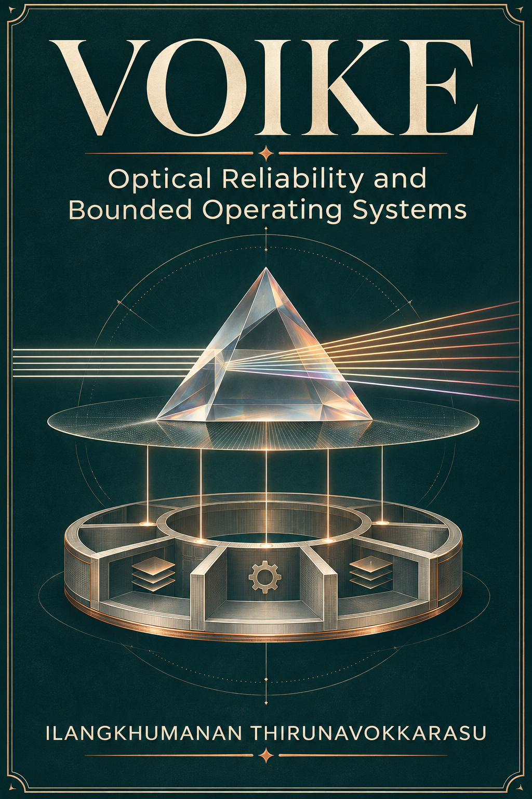
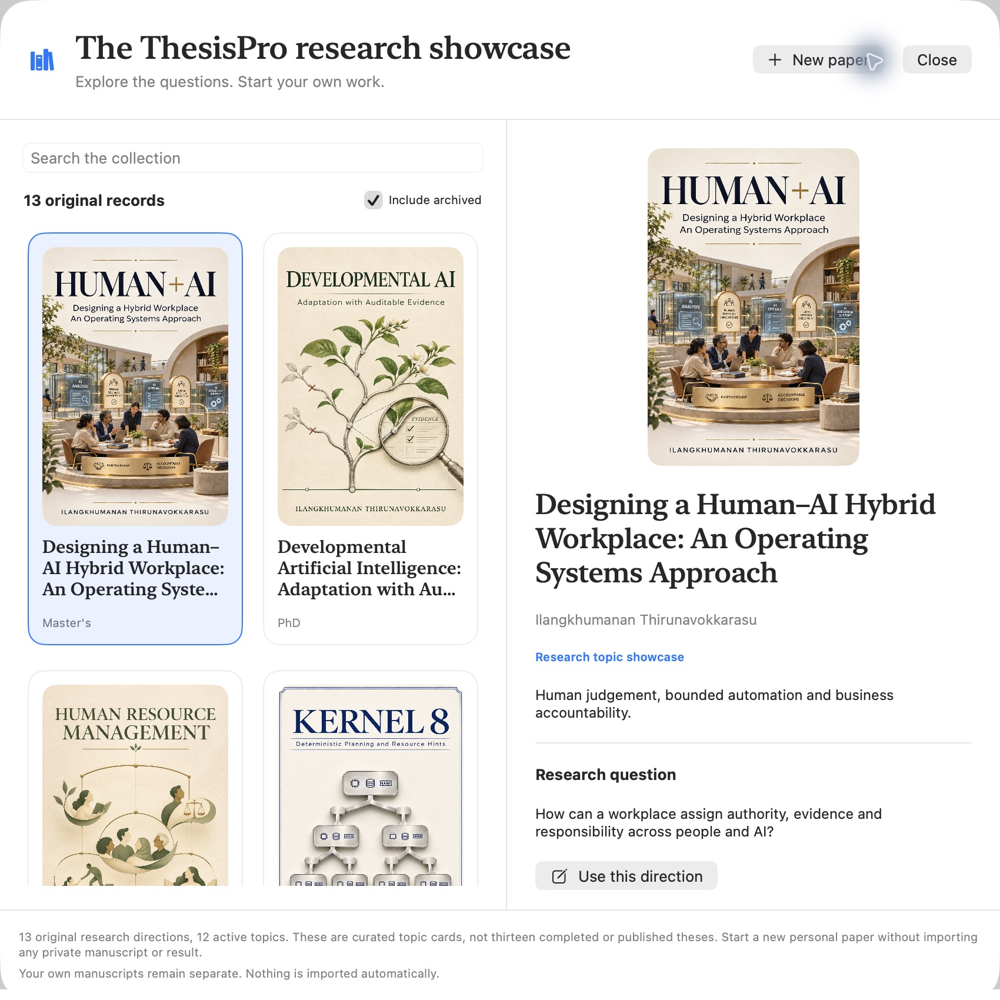
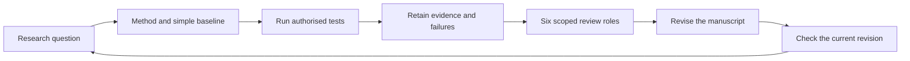

# ThesisPro

**A research workbench where every important claim has somewhere to be challenged.**

ThesisPro combines a native macOS library, manuscript reader and editor with an MCP notebook for an AI host. Chapters, sources, claims, review findings and revision history share a local project record. Built for authors, supervisors and research engineers who want useful work with inspectable evidence.

<p>



</p>

## Explore, then make it yours

The app includes **13 illustrated research directions**, representing 12 active topics and one archived VOIKE OS track. A fresh library opens the showcase; existing users can open it from the toolbar. Search the collection, inspect a question, then start a separate paper with your own title, author and degree.

These are curated topic cards, **not thirteen completed or published theses**. They contain no private manuscripts, student identifiers, participant records or recovered third-party documents. New projects begin without inherited results or approval. [Explore the full showcase](docs/SHOWCASE.md).



## What makes ThesisPro different

* **Evidence travels with the argument.** Connect a concept, passage, evidence locator, decision and limitation. Preserve failed tests and competing explanations.
* **Reviews belong to a specific revision.** Changed passages require a fresh review. Old notes remain in history instead of silently endorsing new words.
* **Six review roles challenge different weaknesses.** Evidence, methods, replication, critic, ethics and editor roles return scoped findings and disagreements. Research changes make the review stale.
* **One local library, two ways to work.** Read and edit in the Mac app; use the MCP host to research, test, write and record reviews against the same project.
* **A readable research workspace.** Gallery and shelf views, artwork choices, light/dark appearance, reading and presentation modes, rendered tables and local figures, chapter maps and evidence notes.



## The review engine is a protocol, not a pretend academic council

`start_review` creates a revision-bound review and returns role prompts. The AI host performs the analysis and any authorised tests. `record_review` saves explicit findings, evidence locators, limitations and known source IDs. `get_review_status` exposes missing roles, stale revisions and unresolved findings.

The engine does not run a model by itself, employ professors, produce independent peer review or prove a hypothesis because six roles responded. It never turns role completion into academic approval. Authors remain responsible for source rights, evidence, declarations and submission requirements. [Review workflow and exact report format](docs/REVIEW-ENGINE.md).

## Clone and build

Requires macOS 15 or later and Swift 6 tools for the native app.

```sh
git clone https://github.com/ilanvkn/ThesisPro.git
cd ThesisPro
zsh macos/scripts/test-journey.sh
zsh macos/scripts/build-app.sh
open macos/dist/ThesisPro.app
```

This development build is ad-hoc signed, not notarized. The source is available for inspection and adaptation. Public binary distribution still needs signing, notarization and broader installation/accessibility testing.

## Connect your AI host

The MCP notebook requires Python 3.10 or later and uses only the standard library.

```sh
python3 plugin/scripts/thesis_pro_mcp.py
```

Configure that command as a **local stdio** server in your MCP client. The default shared library is `~/Documents/ThesisPRO`. `THESIS_PRO_HOME` overrides the MCP server's directory; the native app currently uses the default library. Keep both clients pointed at the same library. Discover the operations through `tools/list`; the plugin manifest is in `plugin/.codex-plugin/`.

Start with a request such as:

> Create a paper from my research question. Establish the contribution, method and simplest credible baseline. Find primary evidence, record precise source support, and keep proposals separate from results. Start a review cycle and work through every role. Preserve disagreements and failed tests; never invent missing evidence.

The host supplies the intelligence and model selection. Installing MCP does not activate Astra, ChatGPT or any other particular model, and it does not create unattended background research.

## Checks and contributions

```sh
python3 -m unittest discover -s plugin/tests -v
zsh macos/scripts/test-journey.sh
```

[Contribute a change](CONTRIBUTING.md), [inspect release checks](RELEASE-CHECKS.md), or [read the security boundary](SECURITY.md). Claim support, bibliographic metadata, artifact identity, reproducibility and independent review are different checks. No similarity score, detector result, novelty claim or publication acceptance is guaranteed.

## Ownership and deployment

Original software and the supplied showcase metadata/artwork are MIT licensed. Showcase artwork is AI-generated interpretation, not experimental evidence or an institutional binding cover. Referenced organisations are research subjects, not sponsors. Users' own papers, source publications and uploaded material retain their own ownership and licences.

ThesisPro is a local research application, not a hosted service qualified for billions of users. Multi-user deployment needs authentication, project permissions, transactional storage, encrypted backups, retention policies and measured load tests. Do not expose the stdio server directly to the internet.
