# Research showcase

Thirteen original research directions illustrate the workbench. Twelve are active topics; VOIKE OS is preserved as a merged historical track. Degree labels describe intended research level, not an awarded degree. These cards do not distribute private manuscripts, claim verified historical publication or certify results.

| Cover | Direction | Status |

|---|---|---|

| 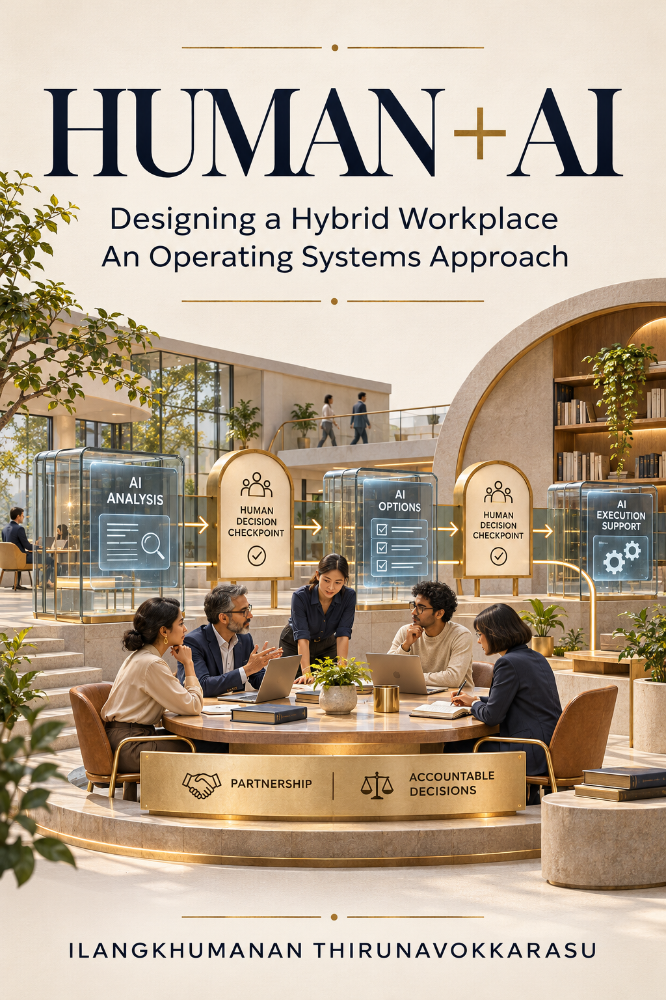 | **Designing a Human–AI Hybrid Workplace: An Operating Systems Approach** Human judgement, bounded automation and business accountability. | Research topic showcase |

| 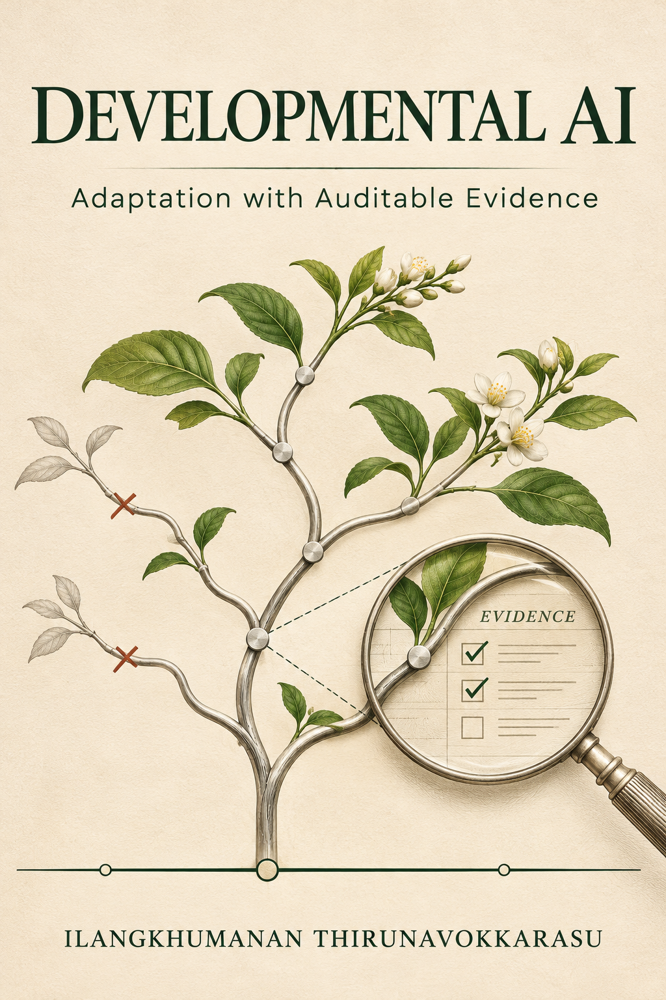 | **Developmental Artificial Intelligence: Adaptation with Auditable Evidence** Prediction complexity must earn its calibration and operating cost. | Working research; independent validation pending |

| 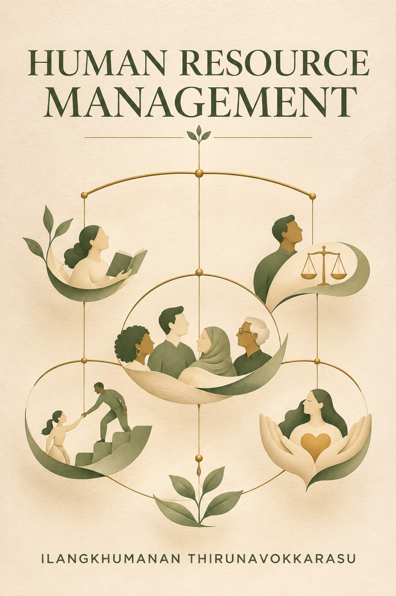 | **Human Resource Management** A foundation for examining workforce practices through explicit evidence. | Research foundation |

| 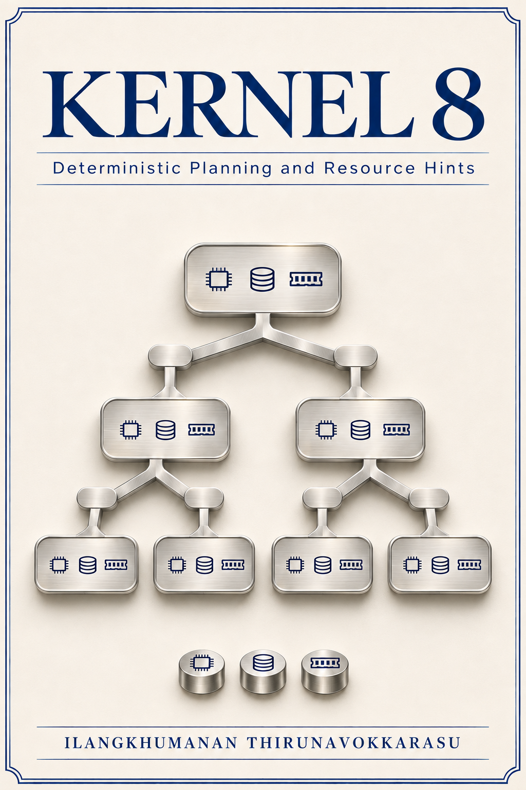 | **Kernel 8: Deterministic Planning and Resource Hints** Resource-aware planning with inspectable decisions and bounded costs. | Research foundation |

| 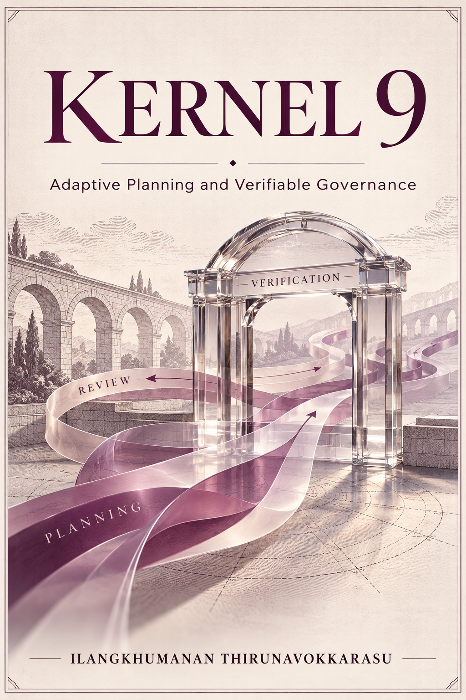 | **Kernel 9: Adaptive Planning and Verifiable Governance** Adaptive recommendations constrained by explicit governance. | Research foundation |

| 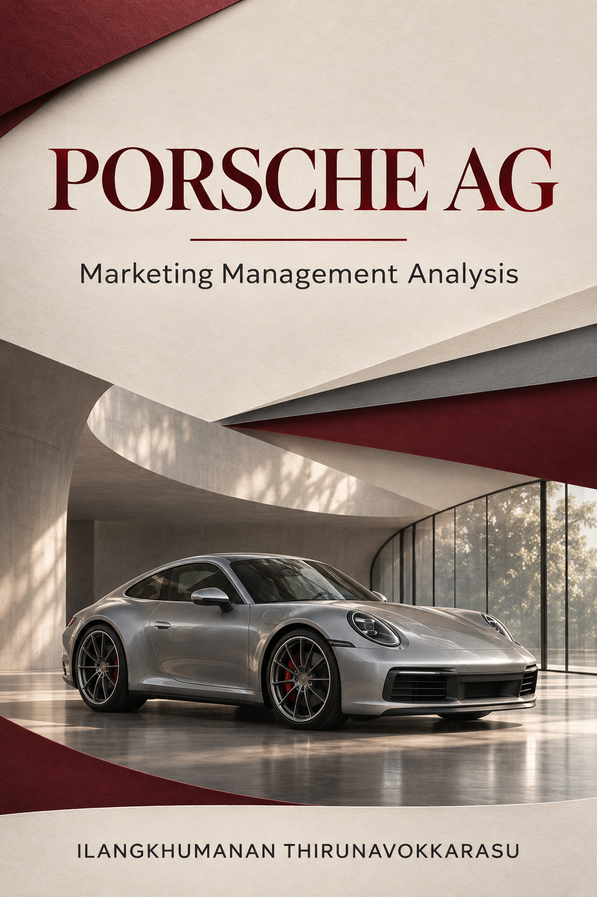 | **Marketing Management Analysis of Porsche AG** An independent strategy research topic, not a company endorsement. | Research foundation |

| 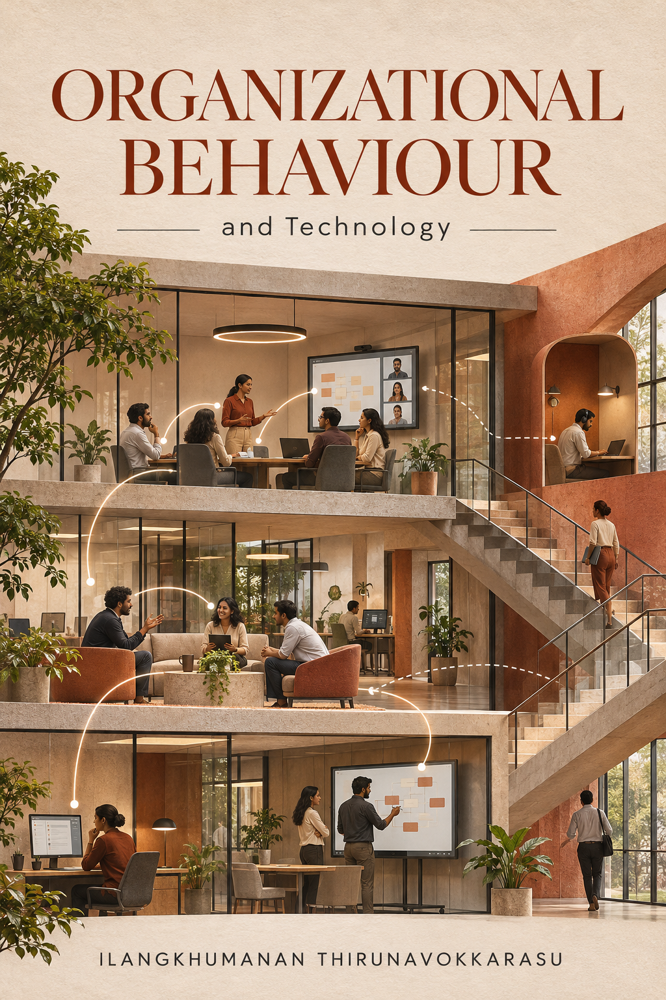 | **Organizational Behaviour and Technology** Technology adoption examined alongside roles, incentives and behaviour. | Research foundation |

| 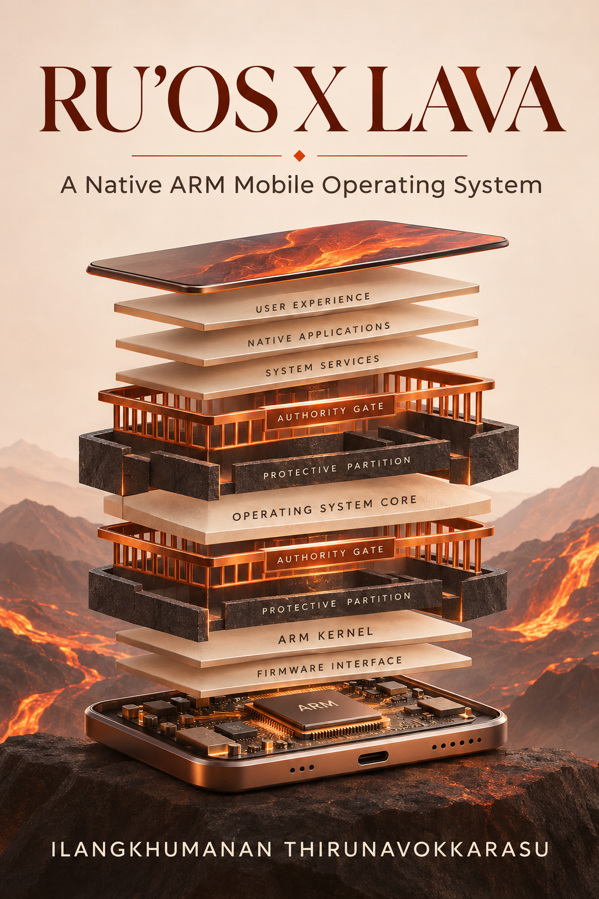 | **RU’OS X Lava: A Native ARM Mobile Operating System** Versioned evidence for capability boundaries and recovery conditions. | Working research; broader qualification pending |

| 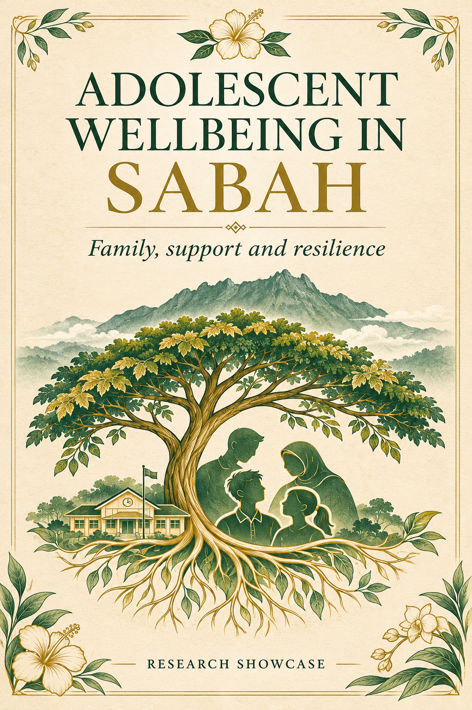 | **Adolescent Wellbeing in Sabah** A topic-only example about family functioning, social support and resilience. No private study or participant records are distributed. | Topic-only showcase; private manuscript excluded |

| 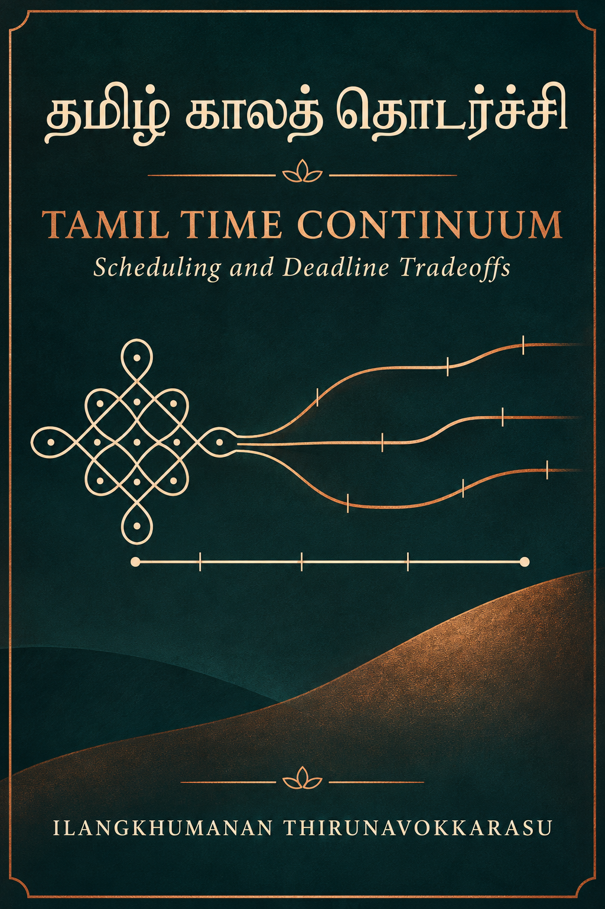 | **Tamil Time Continuum: Scheduling and Deadline Tradeoffs** தமிழ் காலத் தொடர்ச்சி. Scheduling research with explicit timing and deadline boundaries. | Working research; application validation pending |

| 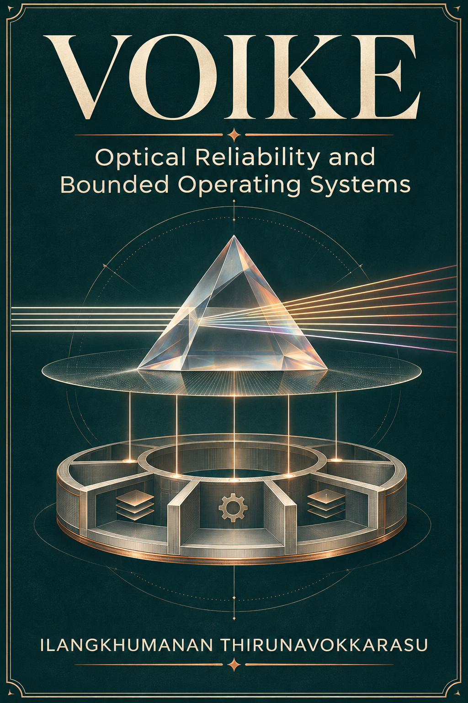 | **VOIKE: Optical Reliability and Bounded Operating Systems** Estimator reliability and proposed OS boundaries are distinct tracks; one does not validate the other. | Computational research; optical validation pending |

| 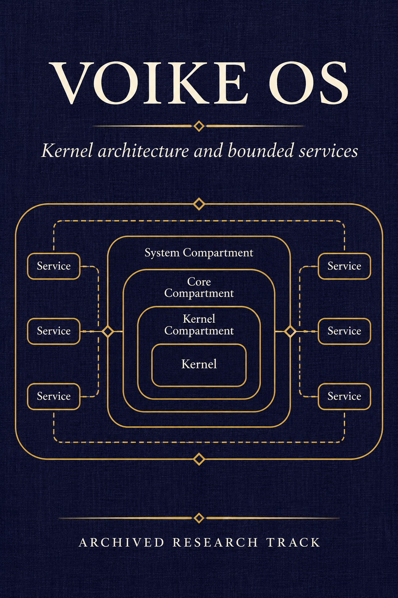 | **VOIKE OS: Kernel Architecture and Bounded Services** A preserved conceptual track now grouped under VOIKE. This card does not assert authorship of recovered documents or a working implementation. | Archived track; merged into VOIKE |

| 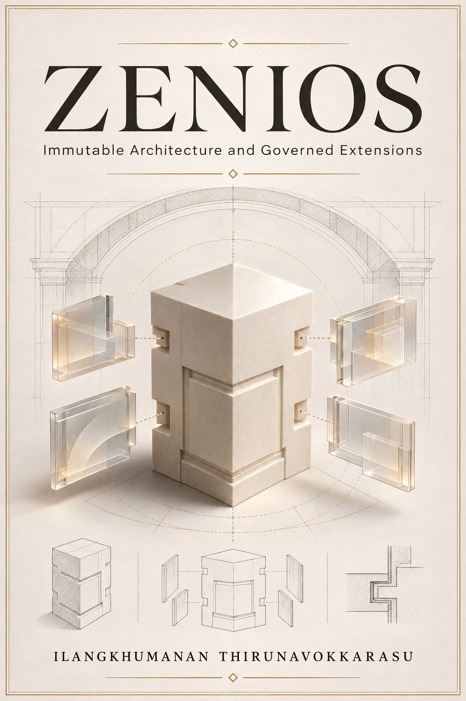 | **ZeniOS: Immutable Architecture and Governed Extensions** A new research foundation around mutation and extension boundaries. Recovered-document authorship is not established by this card. | Research foundation |

## Make it yours

Open Showcase in the app, choose a direction, and select Start a new paper. Confirm your own title, author and degree. ThesisPro creates a separate empty personal project; it does not copy findings, sources, affiliations or approvals from a showcase card.

The public showcase artwork is interpretive AI-generated art. Names such as Porsche are independent research subjects, not sponsors or endorsers. The Sabah topic card intentionally excludes the private thesis author and study records. The VOIKE OS card does not attribute recovered-document authorship.
